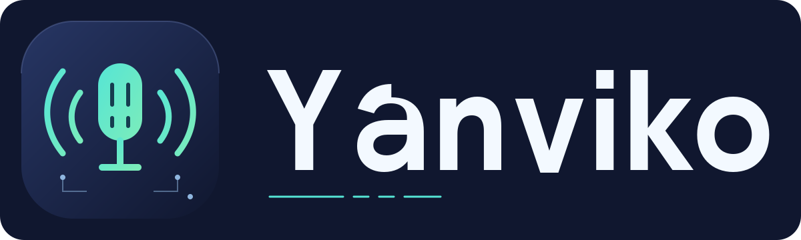
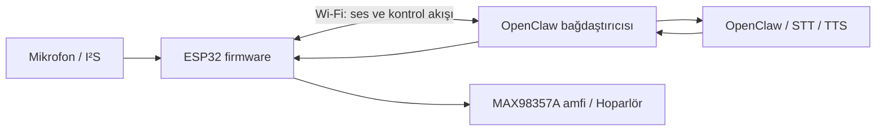

<div align="center">
  

  **OpenClaw için ESP32 tabanlı, açık kaynak sesli arayüz**

  Dinle. Düşün. Yankılan.
</div>

---

> **Durum:** Proje iskeleti ve donanım dokümantasyonu hazırlanıyor. Depoda henüz çalışan
> firmware veya OpenClaw entegrasyonu bulunmuyor.

Yanviko; ESP32-WROOM tabanlı NodeMCU-32S ve Google AIY Voice HAT donanımını, OpenClaw
ile çift yönlü sesli etkileşim kuracak bir yardımcıya dönüştürmeyi hedefler. Proje adı
“yankı” ve “voice/vox” çağrışımlarını birleştirir.

## Hedefler

- I²S mikrofon ile ses yakalama ve I²S amfi ile yanıtı seslendirme
- Sıkıştırılmış ses akışı için Wi-Fi üzerinden düşük gecikmeli iletişim
- OpenClaw tarafında konuşma-metin, ajan ve metin-konuşma orkestrasyonu
- Ağ ve sunucu kimlik bilgilerini cihazın dışında güvenle yapılandırma
- Yeniden üretilebilir bağlantı şeması, firmware ve entegrasyon dokümantasyonu

## Depo yapısı

```text
yanviko/
├── firmware/          # ESP32 firmware kaynakları ve yapılandırması
├── openclaw/          # OpenClaw bağdaştırıcısı ve entegrasyon belgeleri
├── hardware/          # Pin eşlemesi, bağlantı şeması ve kart notları
├── docs/              # Mimari, kurulum ve geliştirme dokümantasyonu
└── assets/brand/      # Özgün SVG logo ve simge
```

## Mimari hedef



Protokol, kimlik doğrulama ve ses formatı henüz kesinleşmemiştir. Uygulama başladığında
bu şema ve ilgili belgeler gerçek davranışa göre güncellenecektir.

## Başlangıç

1. [Donanım ve pin eşlemesini](hardware/README.md) kontrol et.
2. [Mimariyi ve kapsamı](docs/architecture.md) incele.
3. Firmware ve OpenClaw entegrasyonu henüz uygulanmadığından, bu depoyu şimdilik
   donanım doğrulama ve tasarım çalışmaları için kullan.

## Marka

Logo ve simge `assets/brand/` altında kaynak SVG dosyaları olarak sunulur. Harici yazı
tipi veya görsel bağımlılığı yoktur; harfler ve şekiller vektör yollarından oluşturulmuştur.

## Lisans

Bu proje [MIT Lisansı](LICENSE) ile lisanslanmıştır.

---

Google AIY Voice, OpenClaw ve diğer ürün adları ilgili sahiplerine aittir. Yanviko bağımsız
bir projedir; bu ürünlerin sahipleri tarafından desteklendiği veya onaylandığı anlamına gelmez.
